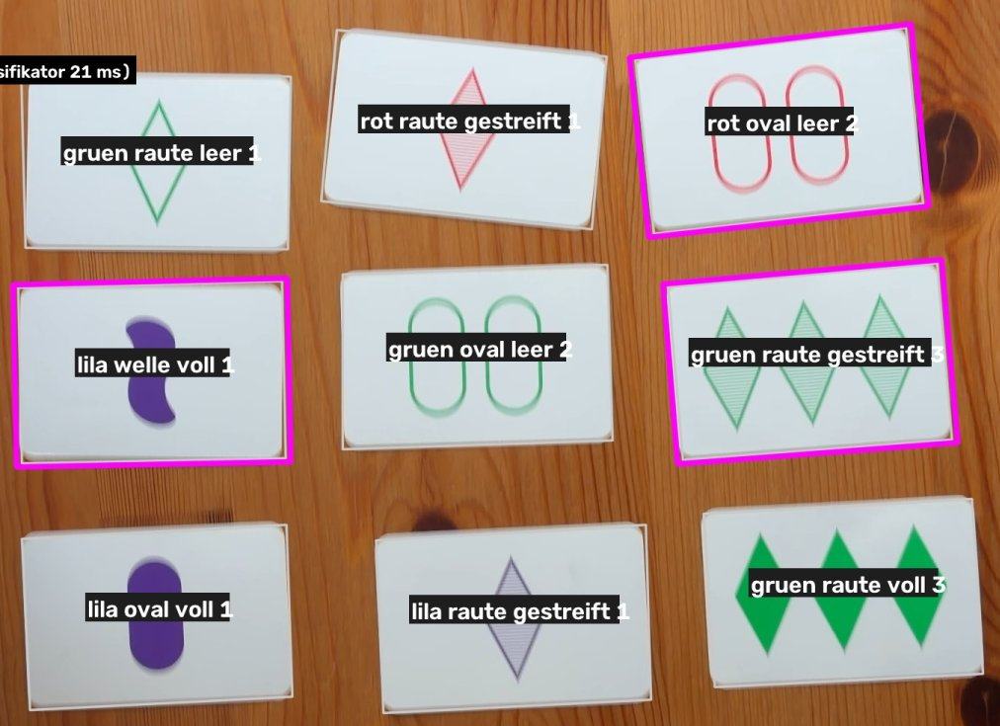

# SET Solver

Erkennt die Karten des Kartenspiels **SET** live per Kamera und zeigt alle Sets, die gerade auf dem Tisch liegen.
Läuft am Mac (Webcam, iPhone als Kamera, Videos, Fotos) und als eigene **iPhone-App** mit etwa 30 Bildern pro Sekunde.



## So funktioniert's

1. **Karten finden:** Ein kleines YOLO-Modell findet jede Karte und ihre vier Ecken, auch schräg von der Seite.
2. **Karte lesen:** Jede Karte wird gerade gezogen. Ein zweites Modell liest dann Farbe, Form, Füllung und Anzahl ab und erkennt auch, wenn etwas gar keine Karte ist.
3. **Sets suchen:** Drei Karten bilden ein Set, wenn jede Eigenschaft bei allen gleich oder bei allen verschieden ist.

Trainiert wurde fast nur mit **künstlich erzeugten Bildern**: Alle 81 Karten wurden als Vektorgrafik nachgebaut und in zufällige Szenen gerendert. Dazu kommen zufälliges Licht, Blickwinkel, Schatten und Unschärfe. Getestet wird mit echten Fotos.

## Ausprobieren

**Am Mac** (Python 3.14):

```bash
python -m venv .venv && .venv/bin/pip install -r requirements.txt
.venv/bin/python scripts/live.py --list-cameras     # Kameras anzeigen
.venv/bin/python scripts/live.py --source 0         # live mit Kamera 0
.venv/bin/python scripts/live.py --source video.mov # oder ein Video / Foto / Ordner
```

Tasten: `q` beenden, Leertaste Pause, `a` alle Sets / einzeln, Tab nächstes Set, `s` Bild speichern.

**iPhone:** Öffne `ios/SetSolver.xcodeproj` in Xcode, wähle unter *Signing & Capabilities* dein Team (eine kostenlose Apple-ID reicht), stecke das iPhone an und drücke ▶ Run.
In der App wechselst du mit 1× / 0.5× zur Weitwinkelkamera. Tippen aufs Bild zeigt das nächste Set.

## Aufbau

| Ordner | Inhalt |
| --- | --- |
| `setcards/` | Kartenmodell, Renderer, Szenengenerator, Klassifikator, Live-Pipeline, Set-Logik |
| `scripts/` | Daten erzeugen, trainieren, auswerten, Live-Erkennung, Export fürs iPhone |
| `models/` | trainierte Modelle (Detektor, Klassifikator) |
| `ios/` | iPhone-App (SwiftUI + CoreML) |
| `docs/projektplan.md` | Plan, Zwischenstände und Messergebnisse |

Modelle für die App aktualisieren: `.venv-coreml/bin/python scripts/export_coreml.py`. Das braucht eine eigene Umgebung mit Python 3.12, weil es coremltools noch nicht für 3.14 gibt. Danach in Xcode einfach neu bauen.
